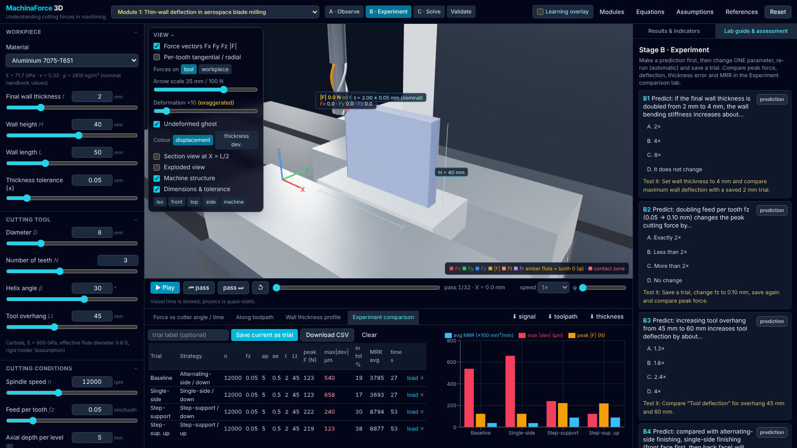
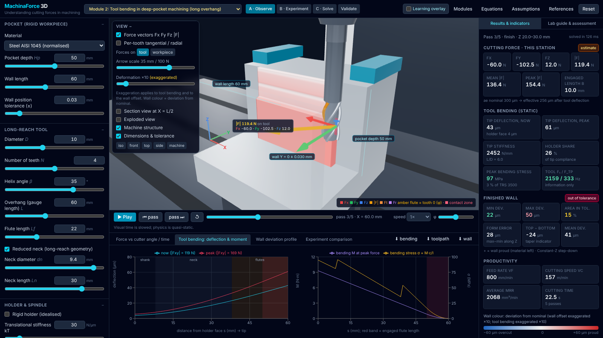

# MachinaForce 3D

### Understanding Cutting Forces in Machining — an interactive 3D CNC learning laboratory

▶ **Open the app: [nabilkhalil.github.io/MachinaForce3D](https://nabilkhalil.github.io/MachinaForce3D/)**

MachinaForce 3D lets you **see** cutting forces. You set up a milling operation on a virtual CNC machining centre, press **Play**, and watch the force vectors, the bending of the wall or the tool, and the error that this bending leaves on the finished part. Change one parameter and the physics is recomputed in about a second.

- **A simulator, not an animation.** Every arrow, colour, graph and chip of removed stock comes from engineering calculations: a mechanistic milling-force model, a finite-element model of the workpiece and a beam model of the tool.
- **Runs in your browser.** No installation, no login, no licence. Your answers and trials are saved only in your own browser.
- **Honest about its limits.** Results are labelled *estimate* unless you enter calibrated cutting coefficients, and every assumption is listed in the app.


---

## Contents

1. [Start here (5 minutes)](#start-here-5-minutes)
2. [The screen at a glance](#the-screen-at-a-glance)
3. [Module 1 — Thin-wall milling: step by step](#module-1--thin-wall-milling-step-by-step)
4. [Module 2 — Tool bending in a deep pocket: step by step](#module-2--tool-bending-in-a-deep-pocket-step-by-step)
5. [The three learning stages and your score](#the-three-learning-stages-and-your-score)
6. [Reading the results correctly](#reading-the-results-correctly)
7. [Key equations](#key-equations)
8. [Tips, common mistakes and FAQ](#tips-common-mistakes-and-faq)
9. [Panduan ringkas (Bahasa Melayu)](#panduan-ringkas-bahasa-melayu)
10. [For lecturers](#for-lecturers)
11. [For developers](#for-developers)
12. [References](#references)

---

## Start here (5 minutes)

1. **Open the app:** <https://nabilkhalil.github.io/MachinaForce3D/>. Use Chrome, Edge or Firefox on a laptop or desktop. A tablet works; a phone works for viewing only.
2. **Choose a module** in the dropdown at the top left. Start with **Module 1**.
3. **Press ▶ Play** under the 3D view. The end mill moves along the wall. The **green arrow (Fy)** is the force that pushes the wall and the tool apart.
4. **Tick "Learning overlay"** (top right). Every parameter now explains itself in plain engineering language.
5. **Open the Lab guide** (right panel, *Lab guide & assessment*) and follow **A · Observe → B · Experiment → C · Solve**.
6. At the end, type your name in the Lab guide and press **Report** to download your report (HTML; print it to PDF).

> 💡 Rotate the view with the left mouse button, pan with the right button, zoom with the wheel. The buttons **iso / front / top / side / machine** jump to standard views.

---

## The screen at a glance

| Area | What it is for |
|---|---|
| **Top bar** | Module selector · learning stages (A/B/C/Validate) · Learning overlay · Equations · Assumptions · References · Reset |
| **Left panel** | All machining parameters: workpiece, tool, cutting conditions, strategy, workholding, cutting coefficients |
| **Centre** | The 3D machining centre. The **View** box (top left) controls force arrows, exaggeration, colour map, section and exploded views |
| **Playback bar** | ▶ Play / Pause, previous/next pass, toolpath slider, speed, and **φ** (the cutter angle, i.e. which way tooth 0 points) |
| **Bottom panel** | Graphs synchronised with the tool position, plus the **Experiment comparison** table |
| **Right panel** | *Results & indicators* (forces, deflection, dimensional error, productivity, warnings) or *Lab guide & assessment* |

**Colours used everywhere**

| Colour | Meaning |
|---|---|
| 🔴 red arrow | **Fx**, along the feed direction (X) |
| 🟢 green arrow | **Fy**, normal to the wall (Y) — the one that bends things |
| 🔵 blue arrow | **Fz**, along the spindle axis (Z) |
| 🟠 amber arrow | **\|F\|**, the resultant force |
| 🟠 amber flute | tooth 0 — the tooth whose angle φ is shown in the graphs |
| 🟥 red patch | the tool–workpiece contact zone |

The same X/Y/Z frame is used in the 3D view, the graphs, the equations and the CSV files. By default the arrows show the force **on the tool**. Switch the View box to *workpiece* to see the equal and opposite force (Newton's third law). A table dynamometer measures the force on the workpiece.

---

## Module 1 — Thin-wall milling: step by step

**The problem.** A thin aerospace rib (Al 7075-T651, 50 × 40 mm, 2 mm thick) is finished with an Ø8 mm end mill. The cutting force bends the wall away from the tool, so the tool removes less material than programmed. The wall comes out **too thick**, especially at the top.


1. **Watch one pass.** Press Play and watch the green arrow and the wall. Set *Deformation* to ×30 in the View box to make the bending visible. The colour shows how much the wall moves at this instant.
2. **Read the force graph.** Open **Force vs cutter angle / time**. One pulse is one tooth passing, so 3 teeth give 3 pulses per revolution. The dashed line follows the φ slider.
3. **See the final error.** Drag the toolpath slider to the end. Set *Colour* to **thickness dev.** and open **Wall thickness profile**. Red means thicker than nominal; the shaded band is the tolerance.
4. **Compare strategies.** In *Toolpath strategy*, try **Single-side**, **Alternating**, **Rough all, then finish all** and **Step-support**. Step-support leaves thick stock below each level to support the wall: watch the error drop.
5. **Experiment.** Change *one* thing at a time (feed per tooth, axial depth, wall thickness, tool overhang, up/down milling) and **Save current as trial** each time.



**What you should discover:** wall stiffness grows with *t³*, tool deflection grows with *L³*, edge forces do not scale with feed, and the order of the passes can matter more than the cutting speed.

---

## Module 2 — Tool bending in a deep pocket: step by step

**The problem.** A 50 mm deep pocket wall in steel is finished with a long Ø10 mm end mill (overhang 60 mm, L/D = 6). Here the workpiece is rigid and **the tool bends**, together with its holder. The wall is left standing proud of its nominal position.



1. **Select Module 2** in the top-left dropdown and press **Play**. Set *Deformation* to ×50–×100 to see the tool bend.
2. **Open "Tool bending: deflection & moment".** Deflection is largest at the **tip**; bending moment and stress are largest at the **holder face**. The stress jumps where the tool gets thinner (neck, flutes).
3. **Open "Wall deviation profile".** Every 10 mm level shows the same pattern. The overhang is set by the deepest level, so every level is cut with the same long tool.
4. **Try the remedies:** a shorter overhang, a **rigid holder**, a smaller *ap* or *ae*, **up-milling**, a **spring pass** (repeat the level), or **compensation** (offset the path by the predicted error). Note what each one costs in cycle time.
5. Watch the **Holder share** indicator: about a quarter of the bending comes from the holder and spindle, not the tool.

---

## The three learning stages and your score

| Stage | What you do | Points |
|---|---|---|
| **A · Observe** | Watch the baseline; answer concept questions on force components, deformation and error | 1 per question |
| **B · Experiment** | Make a **prediction first**, then test it by changing one parameter; save and compare trials | 1 per question |
| **C · Solve** | Fix an industrial production problem: meet the tolerance **and** the productivity target, then justify your choice in ≥ 30 words | 3 for the solution + 1 for the justification |
| **Validate** | (Optional, with the lab dynamometer) upload measured forces or wall measurements and compare | — |

- Press **Load the current (failing) programme** in Stage C to start from the problem setup. Don't change the *fixed* items (material, geometry, tool size, tolerance, coefficients), or the check will fail.
- Your justification is checked automatically only for length and key concepts. **Your lecturer grades the reasoning.**
- **Report** downloads an HTML report with your score, configuration, answers and trials, plus a CSV of your trials.

Lab worksheets: [Module 1 worksheet](docs/WORKSHEET.md) · [Module 2 worksheet](docs/WORKSHEET_M2.md)

---

## Reading the results correctly

- **Peak elastic deflection is not the final error.** The wall or tool springs back after the cutter passes. The final error is the relative deflection at the instant each point of the surface is generated.
- **Positive deviation = material left** (wall too thick or proud). Negative = overcut.
- **"estimate"** means the cutting coefficients are illustrative, not measured. Treat the trends as reliable and the absolute numbers as approximate.
- **The model is quasi-static.** The *Dynamics check* compares the tooth-passing frequency with the natural frequency. If the ratio is high, real vibration (chatter) may be worse than predicted.
- **Orange warnings** flag physically doubtful set-ups: holder collision, engaged length longer than the flutes, very long tools, excessive stress.

---

## Key equations

| Quantity | Equation |
|---|---|
| Uncut chip thickness | h(φ) = fz · sin φ |
| Tooth forces | Ft = Ktc·b·h + Kte·b  Fr = Krc·b·h + Kre·b  Fa = Kac·b·h + Kae·b |
| Global forces (on tool) | Fx = −Ft cos φ − Fr sin φ  Fy = Ft sin φ − Fr cos φ  Fz = Fa |
| Engagement | up-milling φ: 0 → arccos(1 − 2ae/D); down-milling φ: π − arccos(1 − 2ae/D) → π |
| Feed rate | vf = n · N · fz (mm/min) |
| Material removal rate | MRR = ae · ap · vf (mm³/min) |
| Cutting speed | vc = π · D · n / 1000 (m/min) |
| Tooth-passing frequency | f_tp = n · N / 60 (Hz) |
| Cantilever deflection | δ = F · L³ / (3 · E · I), with I = b · t³ / 12 for a wall and π·d⁴/64 for a tool |

Open **Equations** in the app for the full model and the sign convention.

---

## Tips, common mistakes and FAQ

- **Change one parameter at a time**, otherwise you cannot tell which change caused the result.
- **Nothing moves?** Press Play. If the tool has reached the end of the path, Play restarts from the beginning.
- **Numbers look frozen while you drag a slider?** The simulation re-runs when you release it (0.1–1 s).
- **Lost your settings?** *Reset* restores the baseline. Saved trials stay until you press *Clear*.
- **Are my answers sent anywhere?** No. Everything stays in your browser. Use *Report* to hand in your work.
- **Can I use my own cutting coefficients?** Yes: *Cutting-force coefficients* in the left panel. Tick "calibrated" only if they come from your own dynamometer tests.
- **Why are Modules 3–6 greyed out?** They are planned and not yet available. The app never presents an unfinished module as working.

---

## Panduan ringkas (Bahasa Melayu)

1. Buka aplikasi: <https://nabilkhalil.github.io/MachinaForce3D/> (Chrome/Edge/Firefox, komputer riba disyorkan).
2. Pilih **Module 1** (dinding nipis) atau **Module 2** (lenturan mata alat dalam poket dalam) di bahagian atas kiri.
3. Tekan **▶ Play**. Anak panah **hijau (Fy)** ialah daya yang menolak dinding dan mata alat menjauhi satu sama lain.
4. Tandakan **Learning overlay** untuk penerangan setiap parameter.
5. Ikut **Lab guide**: **A · Observe → B · Experiment → C · Solve**. Ramal dahulu, kemudian ubah **satu** parameter sahaja dan simpan setiap percubaan (*Save current as trial*).
6. Akhir sekali, isi nama dan tekan **Report** untuk memuat turun laporan.

Nota: nilai daya dan pesongan ialah **anggaran model** (pekali pemotongan ilustratif), bukan ukuran sebenar.

---

## For lecturers

- **Modules:** 1 Thin-wall milling ✅ · 2 Tool bending in deep pockets ✅ · 3 Chatter · 4 Turning slender shafts · 5 Fixture stiffness · 6 Tool wear (planned)
- **Lab link:** the *Validate* stage compares the model with a measured force signal (`angle_deg` or `time_s`, `FX_N`, `FY_N`, `FZ_N`) and with measured wall thickness (Module 1) or wall deviation (Module 2). It reports RMSE and percentage error. *Synthetic example* buttons generate clearly labelled practice files.
- **Offline / LMS:** `npm run build:single` produces one self-contained HTML file that can be uploaded to URLearn or opened without internet.
- **Verification:** 68 automated tests compare the numerical models with analytical solutions (closed-form mean forces, cantilever and stepped-beam deflections, natural frequencies, mesh convergence, volume conservation). See [docs/VALIDATION.md](docs/VALIDATION.md). Verification shows the equations are solved correctly; validation against your own measurements is still required before quoting absolute values.
- **Documentation:** [docs/PHYSICS.md](docs/PHYSICS.md) (models, sign convention, assumptions) · [docs/PROGRESS.md](docs/PROGRESS.md) (milestones, limitations).

---

## For developers

```bash
npm ci
npm run dev          # http://localhost:5173
npm test             # 68 verification tests (Vitest)
npm run build        # production build → dist/
npm run build:single # one self-contained HTML file → dist-single/index.html
```

Stack: React 19, TypeScript, Vite 7, Three.js / React Three Fiber / Drei, Tailwind CSS 4, Zustand, Recharts. The physics in `src/physics/` has no UI dependencies and runs in a Web Worker.

```
src/physics/   force model, plate FE, tool beam, stock model, process simulations
src/scene/     3D machine, workpieces, tools, force vectors
src/ui/        panels, charts, lab guide, assessment, validation
src/content/   learning text, questions, problems, references
tests/         verification suite
docs/          physics, validation, progress, worksheets, images
```

**Deploy (GitHub Pages):** every push to `main` runs `.github/workflows/deploy.yml` (install → test → build → publish). One-time setup: *Settings → Pages → Source: GitHub Actions*. The build uses relative paths, so the same `dist/` also works on Cloudflare Pages (`wrangler.toml` included).

---

## References

1. Lassila et al. (2024). Numerical evaluation of cutting strategies for thin-walled parts. *Scientific Reports*. [doi:10.1038/s41598-024-51883-1](https://doi.org/10.1038/s41598-024-51883-1)
2. Bolar & Joshi (2021). Experimental investigation and optimization of wall deflection and material removal rate in milling thin-wall parts. *Manufacturing Review*. [doi:10.1051/mfreview/2021015](https://doi.org/10.1051/mfreview/2021015)
3. Zawada-Michałowska (2025). Thin Wall Milling at a Maximized Axial Depth of Cut: An Analysis of Thermal and Mechanical Interactions. *Materials*. [doi:10.3390/ma18235347](https://doi.org/10.3390/ma18235347)
4. Si & Wang (2018). Error compensation in the five-axis flank milling of thin-walled workpieces. *Proc. IMechE Part B*. [doi:10.1177/0954405418780163](https://doi.org/10.1177/0954405418780163)
5. Altintas, Y. (2012). *Manufacturing Automation: Metal Cutting Mechanics, Machine Tool Vibrations, and CNC Design* (2nd ed.). Cambridge University Press. (Source of the mechanistic force-model formulation.)

The app uses these works as context and for model formulation. It does not reproduce their numerical results.

---

Developed by **Ts. Dr. Ahmad Nabil bin Mohd Khalil**, Department of Manufacturing, Faculty of Mechanical Engineering & Technology, Universiti Malaysia Perlis (UniMAP), for the Bachelor of Industrial Machining Technology with Honours programme. Built with Claude.
